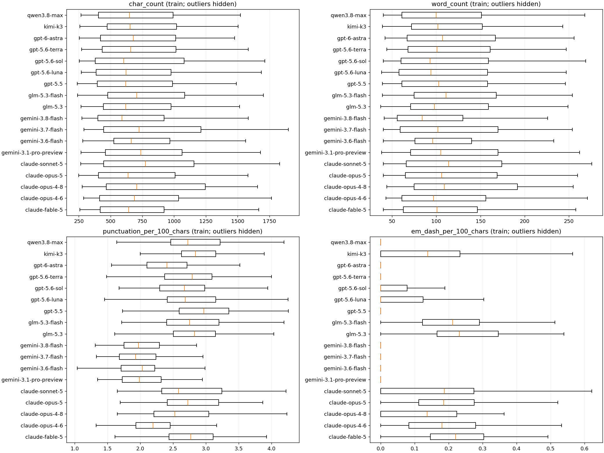
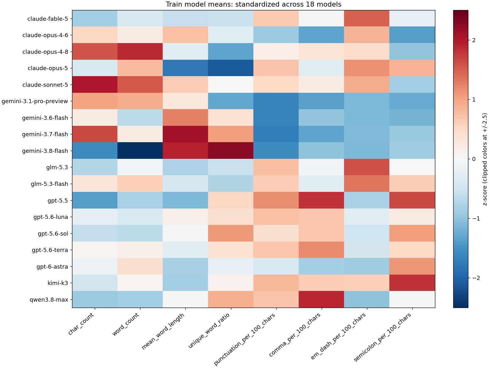

# [B] EDA 및 특징 추출

> 상태: 구현 완료 · 담당: 정혜원 · 최종 수정: 2026-11-11 · B/Codex

## 1. 작업 요약

- A의 `data/split/`을 재분할하지 않고 사용한다.
- 학습 데이터에서 모델별 길이·단어 수·문장부호·Markdown 분포를 분석한다.
- 고전 ML 실험 1과 문체 융합 모델에서 사용할 **공통 문체 특징 32개**를 구현했다. 팀 공통 채택 여부는 팀원 확인이 필요하다.
- 실험 2에 추가할 문자 TF-IDF 및 문체+TF-IDF 결합 추출기를 제공한다.
- 이번 범위는 ROADMAP Phase 1의 B다. SVM·ModernBERT 학습 및 성능 비교는 Phase 2 작업이므로 이 보고서에 성능 수치를 만들지 않는다.

## 2. 분석 데이터와 원칙

EDA는 `train.csv` 1,889개(105개 질문, 18개 모델)에 한정한다. 검증·테스트의 모델별 분포를 살펴 특징을 선택하지 않는다. 그래프는 학습 데이터의 기술 통계이며, 새로운 질문에서도 동일한 차이가 유지된다는 성능 검증은 아니다.

원문을 소문자로 바꾸거나 문장부호·Markdown·줄바꿈을 제거하지 않는다. `id`, `prompt_id`, `model`은 입력 특징에 넣지 않는다. `prompt_id`는 분할 검사와 같은 질문 내 평균 차이를 분석할 때만 사용한다.

## 3. EDA 결과

실측 요약은 아래 결과 표와 그래프를 참조한다. `train_model_summary.csv`에는 32개 특징의 평균·중앙값·표준편차·최솟값·최댓값을 모두 저장한다.

| 모델 | 글 수 | 평균 문자 수 | 평균 단어 수 | 문자 100개당 부호 수 |
| --- | ---: | ---: | ---: | ---: |
| claude-fable-5 | 104 | 720.5 | 113.6 | 2.82 |
| claude-opus-4-6 | 105 | 777.0 | 117.2 | 2.28 |
| claude-opus-4-8 | 105 | 821.2 | 127.8 | 2.65 |
| claude-opus-5 | 105 | 739.7 | 120.9 | 2.85 |
| claude-sonnet-5 | 105 | 839.2 | 125.7 | 2.77 |
| gemini-3.1-pro-preview | 105 | 796.6 | 121.9 | 2.01 |
| gemini-3.6-flash | 105 | 764.5 | 112.0 | 2.01 |
| gemini-3.7-flash | 105 | 823.9 | 117.3 | 1.99 |
| gemini-3.8-flash | 105 | 690.0 | 98.9 | 2.05 |
| glm-5.3 | 105 | 725.5 | 115.5 | 2.86 |
| glm-5.3-flash | 105 | 768.8 | 119.9 | 2.82 |
| gpt-5.5 | 105 | 698.5 | 111.0 | 3.01 |
| gpt-5.6-luna | 105 | 745.4 | 113.7 | 2.86 |
| gpt-5.6-sol | 105 | 730.0 | 112.0 | 2.74 |
| gpt-5.6-terra | 105 | 758.2 | 116.9 | 2.84 |
| gpt-6-astra | 105 | 749.3 | 118.6 | 2.46 |
| kimi-k3 | 105 | 736.6 | 116.5 | 2.89 |
| qwen3.8-max | 105 | 717.5 | 110.7 | 2.85 |

### 주요 발견

- **길이:** 모델별 평균 문자 수는 `gemini-3.8-flash` 690.0자부터 `claude-sonnet-5` 839.2자까지다. 평균 단어 수는 98.9~127.8개다. 모델별 길이 분포가 크게 겹치므로 길이만으로 분류 가능하다고 단정하지 않는다.
- **문장부호:** 문자 100개당 문장부호 평균은 `gemini-3.7-flash` 1.99개, `gpt-5.5` 3.01개다. Gemini 4개 모델의 평균은 약 1.99~2.05개로 비교적 낮다.
- **긴 대시(`—`):** 문자 100개당 평균이 `glm-5.3` 0.2394개, `claude-fable-5` 0.2272개다. Gemini 3개 모델은 0, `gemini-3.7-flash`는 0.0020개다. 유력한 문체 후보지만 분류 기여도는 아직 검증하지 않았다.
- **형식 정보의 한계:** train 응답은 모두 한 줄이다. `line_count=1`이고 빈 줄·제목·글머리·번호 목록·코드 경계·강조·링크·백틱 특징은 모두 0이다. 총 32개 중 9개가 상수여서 이 train에서 변하는 특징은 23개다. 공통 입력 규격을 위해 32개를 유지하되, 상수 특징은 현재 분류 신호를 제공하지 않는다. 원래 생성 응답에서 형식 정보가 제거됐는지는 이 파일만으로 판단할 수 없다.
- **데이터 품질:** train 필수 값 결측·빈 텍스트·중복 ID·중복 텍스트가 없다. 모델당 105개이며 `claude-fable-5`만 104개다.



상자 그림은 중앙값과 분포를 비교한다. 가독성을 위해 이상치 점은 숨겼지만 통계 계산과 CSV에는 전체 행을 포함했다.



색상은 각 특징의 18개 모델 평균을 다시 표준화한 값이다. 원래 단위의 차이나 분류 성능을 뜻하지 않는다. `train_prompt_centered.csv`는 각 응답의 특징에서 같은 질문에 대한 응답 평균을 뺀 뒤 모델별로 평균낸 보조 분석이다. 이 값은 모델 입력으로 사용하지 않는다.

## 4. 공통 문체 특징 정의

| 구분 | 특징 | 정의 |
| --- | --- | --- |
| 길이 4개 | `char_count`, `word_count`, `sentence_count`, `line_count` | 공백 포함 문자 수, 단어 수, 비어 있지 않은 문장 조각 수, 줄 수 |
| 단어·문장 4개 | `mean_word_length`, `mean_sentence_words`, `word_length_std`, `unique_word_ratio` | 단어 길이 평균, 단어 수/문장 수, 단어 길이 표준편차(ddof=0), 고유 단어 수/단어 수 |
| 문자 구성 5개 | `uppercase_ratio`, `digit_ratio`, `whitespace_ratio`, `non_ascii_ratio`, `punctuation_per_100_chars` | 앞 4개는 문자 비율(0~1), 문장부호는 Unicode P 범주 문자 수/문자 수×100 |
| 줄 구성 5개 | `blank_line_ratio`, `heading_per_100_lines`, `bullet_per_100_lines`, `numbered_per_100_lines`, `code_fence_per_100_lines` | 빈 줄 비율(0~1), 제목·글머리·번호 목록·코드 경계 줄 수/전체 줄 수×100 |
| Markdown 2개 | `bold_per_100_chars`, `link_per_100_chars` | `**강조**`, `[이름](주소)` 출현 수/문자 수×100 |
| 부호 12개 | `period`, `comma`, `question`, `exclamation`, `colon`, `semicolon`, `hyphen`, `em_dash`, `parenthesis`, `quote`, `asterisk`, `backtick` + `_per_100_chars` | 각 부호 문자 수/전체 문자 수×100; 괄호는 `()`, 인용부호는 ASCII 및 곡선형 따옴표 합산 |

단어는 Unicode 문자·숫자 연속이며 내부 `'`/`’`를 허용한다. 고유 단어 수 계산에만 대소문자를 통일한다. 문장은 `. ! ? 。 ！ ？` 또는 줄바꿈으로 자른 비어 있지 않은 조각이다. 언어 분석기 기반 문장 구분이 아니므로 소수점·약어·코드에서 과대 계산될 수 있다. 코드 블록 내부를 별도로 제외하지 않으며, 여닫는 코드 경계는 각각 센다. 빈 문자열은 0 벡터로 처리하지만 데이터 파일의 결측치·빈 텍스트는 오류로 중단한다.

길이 자체가 작성 스타일의 단서일 수 있어 절대 개수도 유지한다. 부호·구조 비율을 함께 제공해 긴 응답이라는 이유만으로 모든 부호 수가 커지는 문제를 줄인다. 특징은 서로 상관될 수 있으며, 중요도는 향후 학습 모델에서 확인해야 한다.

## 5. TF-IDF 및 전처리

TF-IDF는 여러 글에 흔한 문자열의 가중치를 낮추고 특정 글에서 두드러진 문자열을 수치화하는 방식이다.

| 항목 | 설정 |
| --- | --- |
| 단위 | 문자 3~5개 연속 조각(`analyzer='char'`) |
| 대소문자 | 유지(`lowercase=False`) |
| 최소 출현 문서 | train에서 2개 이상 |
| 최대 차원 | 30,000개; 실제 차원은 학습 데이터로 결정 |
| 빈도 변환 | `sublinear_tf=True` |
| 정규화 | TF-IDF 기본 L2, IDF smoothing 사용 |
| 문체 스케일링 | train에서만 `StandardScaler(with_mean=False)` 학습 |
| 결합 | 스케일링한 문체 32차원 뒤에 TF-IDF를 연결 |

scikit-learn TF-IDF의 기본 처리로 연속 공백이 축약될 수 있다. 원문의 정확한 공백·줄바꿈 비율은 문체 추출기가 별도로 보존한다. 문자 TF-IDF도 주제 단어를 학습할 수 있으므로, 처음 보는 질문에 대한 val 평가로 효과를 확인해야 한다. 이 설정은 B의 시작점이며 최적 성능을 검증한 결과가 아니다. 문체와 TF-IDF 블록의 상대 가중치는 향후 val에서 조정할 수 있다.

문체의 원래 단위가 필요한 RF/XGBoost 또는 특징 해석에는 `StylometricTransformer`의 원시 값을 사용한다. SVM/LR/융합 신경망에는 train으로 학습한 스케일러를 적용한다.

## 6. 실행 방법과 팀원 사용 예시

저장소 최상위에서 Python 3.12로 실행했다. A 데이터가 포함된 B 브랜치에서 바로 실행할 수 있다.

```bash
python -m pip install -r requirements-b.txt
python -m features.eda
python -m features.build --kind style
python -m features.build --kind tfidf
python -m features.build --kind combined
python -m unittest discover -s tests -v
```

출력은 `artifacts/features/{style,tfidf,combined}/`에 저장된다. 이 폴더는 용량과 중복을 줄이기 위해 Git에서 제외했다. `train.npz`·`val.npz`는 희소 행렬 파일(0을 생략해 저장), `*_rows.csv`는 같은 행 순서의 `id/prompt_id/model`, `feature_names.json`은 열 순서, `extractor.joblib`은 train으로 학습한 변환기, `manifest.json`은 입력 파일 해시·버전·크기다. 배열을 따로 정렬하지 말고 반드시 대응하는 행 파일과 함께 읽는다.

테스트 특징은 기본 생성하지 않는다. 최종 설정을 확정한 시점에 `python -m features.build --kind combined --include-test`로 같은 train 학습 변환을 적용할 수 있다. 테스트 점수를 보고 특징을 다시 고르지 않는다.

Python에서 원시 문체 특징만 사용하는 예:

```python
import pandas as pd
from features.stylometry import StylometricTransformer

train = pd.read_csv('data/split/train.csv')
val = pd.read_csv('data/split/val.csv')
extractor = StylometricTransformer().fit(train.text)
X_train = extractor.transform(train.text)  # (1889, 32)
X_val = extractor.transform(val.text)      # (396, 32)
names = extractor.get_feature_names_out()
y_train = train.model  # 정답은 별도로 관리
```

`make_extractor('combined')`를 분류기 앞의 sklearn `Pipeline`에 연결해도 된다. 학습은 `train.text`에만 한다. SVM 확률 보정 시에는 C 안내대로 train 내부에서 `prompt_id` 그룹이 겹치지 않게 나눠야 한다. B 추출기는 정답 확률이나 C의 예측 파일을 만들지 않는다. 확률의 열 순서는 A `label_map.json` 및 C `CLASSES`와 맞춘다.

## 7. 산출물과 범위

| 산출물 | 경로 |
| --- | --- |
| 문체 추출기 | `features/stylometry.py` |
| TF-IDF·스케일링·행렬 생성 | `features/build.py` |
| 재현 가능한 분석 코드 | `features/eda.py` |
| 모델별 통계·질문별 평균 보정 통계·원시 특징 | `results/b_eda/*.csv` |
| 분포 그림·문체 비교 그림 | `results/b_eda/*.png` |
| 데이터 해시·분석 환경 | `results/b_eda/metadata.json` |
| 검증 코드 | `tests/test_b_features.py` |
| 설치 의존성 | `requirements-b.txt` |

첨부 ROADMAP과 A/C/D 문서는 작업 범위와 보고 형식의 참고 자료로 읽었다. A의 분할, C의 평가 코드, D의 실험 설정은 수정하지 않았다. D의 템플릿은 Macro F1, C의 최신 자료는 BA(모델별 재현율의 평균)를 모델 선택 기준으로 적어 서로 차이가 있다. B 범위에서는 모델을 선택하지 않으며 Phase 2 전에 팀에서 기준을 맞출 필요가 있다.

## 8. 실행 검증

2026-11-11, Windows / Python 3.12.2 / NumPy 2.4.4 / pandas 3.0.2 / scikit-learn 1.6.1 / SciPy 1.15.3 / matplotlib 3.10.9 / joblib 1.4.2에서 확인했다. 실제 실행 버전은 `requirements-b-tested.txt`에도 기록했다.

| 확인 항목 | 결과 |
| --- | --- |
| A 브랜치 CSV와 첨부 CSV 일치 | train·val·test 모두 내용 일치; 재분할 없음 |
| 단어·문자·부호 계산, 빈 문자열·한국어 처리 | 통과 |
| Markdown 계산·입력 순서 유지 | 통과 |
| val 변환 전후 train 특징·어휘 불변 | style·tfidf·combined 모두 통과 |
| 파일 저장 후 행 순서·저장 변환기 복원·질문 중복 거부 | 통과 |
| 실제 문체 행렬 | train `(1889, 32)`, val `(396, 32)` |
| 실제 TF-IDF 행렬 | train `(1889, 30000)`, val `(396, 30000)` |
| 실제 결합 행렬 | train `(1889, 30032)`, val `(396, 30032)` |
| EDA 통계·그림 생성 | 완료; 그림 표시와 라벨 잘림 여부 확인 |

단위 검증은 총 4개 테스트가 통과했다. test는 첨부 데이터와의 동일성 확인에만 읽었고, EDA·특징 선택·모델 학습·평가에는 사용하지 않았다. test 특징도 생성하지 않았다. 유료 API는 호출하지 않았다.
