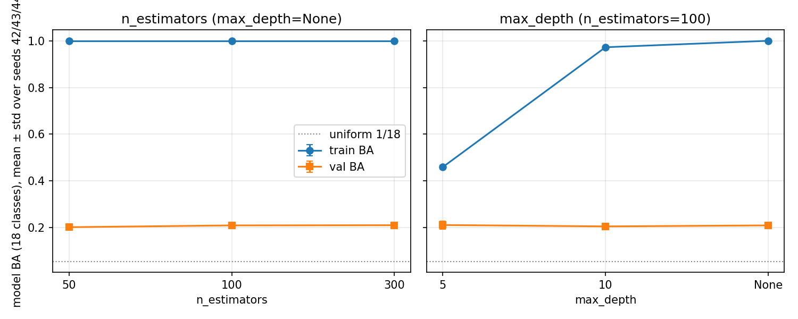
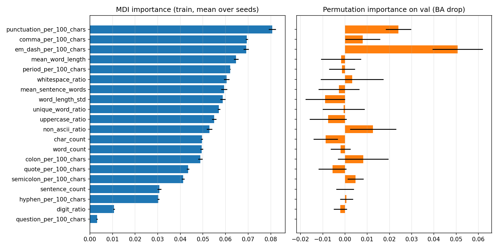
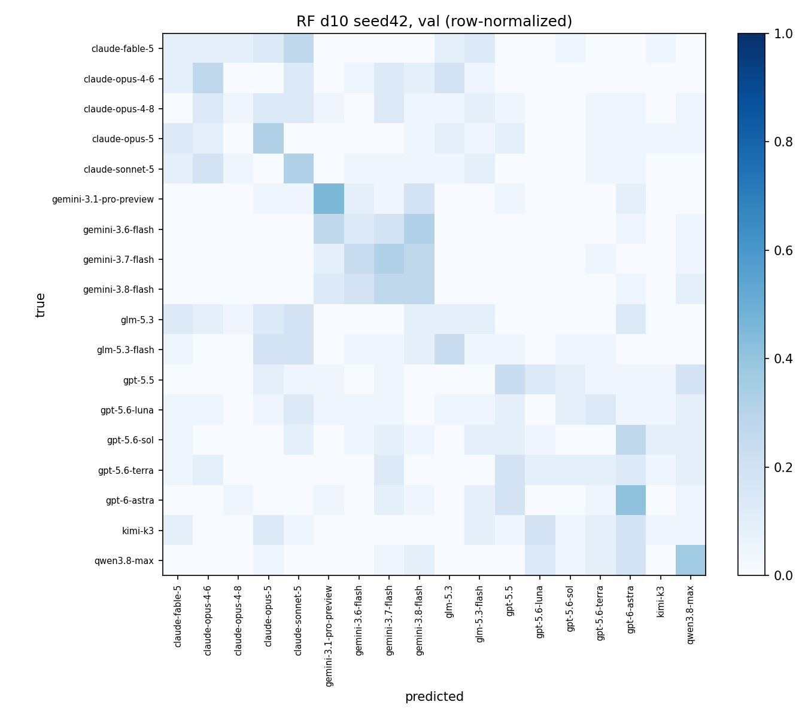
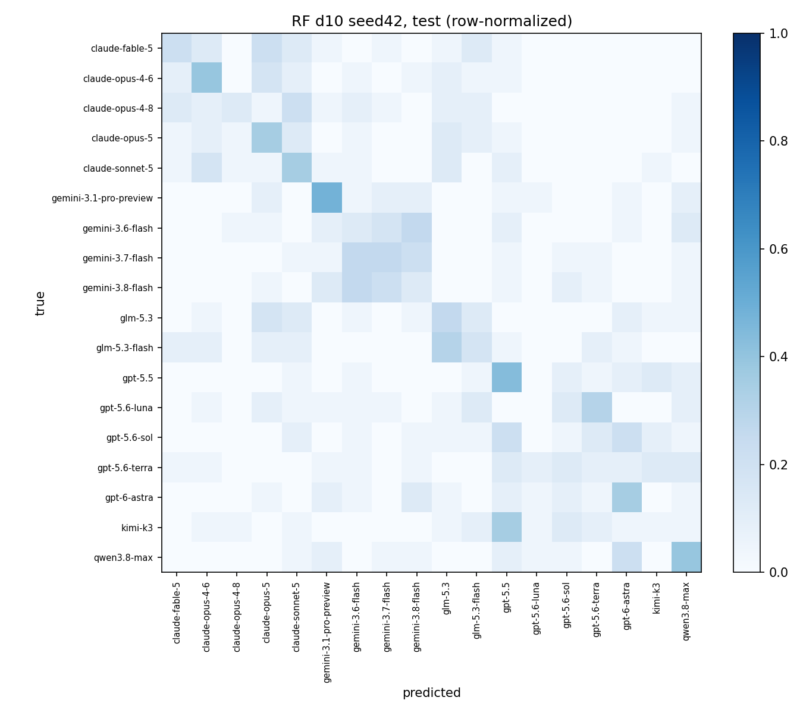

# [A] Random Forest — 공통 문체 특징 32개

> 상태: 실험 완료 · 보고서 초안 · 담당: 좌은진(A) · 작성: 2026-11-17 · A/Claude
> 미완료: 데이터 출처(A-1), C의 XGBoost와 비교(C 결과 대기), Kaggle 노트북 링크

## 1. 실험 개요

| 항목 | 내용 |
| --- | --- |
| 담당자 | 좌은진 (A) |
| 실행 환경 | Kaggle Notebook, CPU 4코어, Linux (glibc 2.39) |
| Python / NumPy / pandas / scikit-learn | 3.13.18 / 2.1.3 / 2.3.3 / 1.6.1 |
| 추가 라이브러리 | SciPy 1.16.3, matplotlib 3.10.0 |
| 실험 모델 | `RandomForestClassifier` |
| 모델 구분 | 고전 ML |
| 실험 날짜 | 2026-11-17 |
| 코드 | `eunjin` 브랜치 `experiments/A_random_forest.py`, 커밋 `b416867` |

## 2. 실험 설정

### 2.1 데이터

| 항목 | 내용 |
| --- | --- |
| 데이터셋 | Name that LLM (2026) — 출처·사용 조건 **미기록** |
| 분할 | A 공통 분할 그대로 사용 (`data/split/`) |
| Train / Val / Test | 1,889 / 396 / 414 (질문 105 / 22 / 23개) |
| 분할 기준 | `prompt_id` 단위, seed 42, 분할 간 질문 겹침 0 |
| 분류 대상 | 작성 모델 18개 (개발사 6개는 확률 합산으로 별도 평가) |

### 2.2 입력 특징

| 항목 | 내용 |
| --- | --- |
| 입력 | `text` 열 |
| 특징 | B의 공통 문체 특징 32개 (`features/stylometry.py`) |
| 전처리 | 없음. 트리는 값의 크기에 영향을 받지 않아 스케일링하지 않음 |
| 특징 차원 | 32 (train에서 상수인 특징 9개 포함, 실제로 변하는 특징 23개) |
| 상수 특징 | `line_count`, `blank_line_ratio`, 제목·글머리·번호·코드 경계 비율, 굵은 글씨·링크·백틱 비율 |

문체 특징은 글 하나만 보고 계산하는 고정 공식이라 데이터에서 학습되는 값이 없다. 따라서 val/test 정보가 학습에 들어가지 않는다.

### 2.3 모델과 설정

| 항목 | 기록 |
| --- | --- |
| 기본 설정 | `n_estimators=100`, `max_depth=None`, `min_samples_leaf=1` (계획 문서의 시작 설정) |
| 비교 1: 트리 수 | 50 / 100 / 300 (깊이 제한 없음 고정) |
| 비교 2: 최대 깊이 | 5 / 10 / None (트리 100개 고정) |
| 설정 수 | 5개 (100/None을 두 비교에서 공유) |
| seed | 모든 설정을 42 / 43 / 44로 반복 |
| 선택 기준 | val 18개 모델 BA 평균 1위와의 차이가 1위의 seed 표준편차 이내인 설정 중 val log loss가 가장 낮은 설정 (C의 기존 규칙) |
| 최종 설정 | **d10** (`n_estimators=100`, `max_depth=10`) |
| 최종 학습 | train만으로 학습 (train+val 재학습 안 함) |
| 확률 출력 | `predict_proba` (트리별 잎 비율의 평균), 별도 보정 없음 |

## 3. 결과

### 3.1 설정 비교 (val, seed 3개 평균 ± 표준편차)

| 설정 | 바꾼 조건 | train BA | val BA | train−val 차이 | val Macro F1 | val log loss | 학습 시간(초) |
| --- | --- | ---: | ---: | ---: | ---: | ---: | ---: |
| Dummy (사전확률) | 기준선 | – | 0.0556 | – | 0.0058 | – | – |
| n50 | 트리 50 | 1.000 | 0.202 ± 0.012 | 0.798 | 0.189 | 4.63 | 0.25 |
| n100 | 기본 | 1.000 | 0.210 ± 0.009 | 0.790 | 0.195 | 3.56 | 0.47 |
| n300 | 트리 300 | 1.000 | 0.210 ± 0.013 | 0.790 | 0.198 | 2.57 | 1.41 |
| d5 | 깊이 5 | 0.460 | 0.211 ± 0.017 | 0.248 | 0.177 | 2.46 | 0.32 |
| **d10** | 깊이 10 | 0.973 | 0.205 ± 0.013 | 0.767 | 0.185 | **2.41** | 0.41 |



- 다섯 설정의 val BA 차이(최대 0.009)는 seed만 바꿨을 때의 흔들림(0.009~0.017)보다 작다. 이 데이터에서 트리 수와 깊이는 val 성능을 의미 있게 바꾸지 못했다.
- 선택 규칙상 모든 설정이 후보에 들어가 log loss가 가장 낮은 d10이 선택됐다. val BA 평균 1위는 d5였으나 차이는 seed 변동 범위 안이다.

### 3.2 개별 모델 18개 (d10, seed 3개 평균)

| 지표 | Validation | Test |
| --- | ---: | ---: |
| BA = Macro Recall | 0.205 ± 0.013 | **0.240 ± 0.012** |
| Accuracy | 0.205 | 0.240 |
| Macro Precision | 0.179 | 0.233 |
| Macro F1 | 0.185 | 0.228 |
| Weighted F1 | 0.185 | 0.228 |
| Log loss / ECE | 2.411 / 0.037 | 2.302 / 0.046 |
| 형제 정확도 | 0.351 | 0.392 |
| BA 95% 신뢰구간 (질문 단위 bootstrap 1,000회) | – | 0.200 ~ 0.279 |

클래스별 표본 수가 거의 같아 BA와 Accuracy, Macro F1과 Weighted F1이 같게 나온다.

### 3.3 개발사 6개 (d10, seed 3개 평균, 확률 합산 방식)

| 지표 | Validation | Test |
| --- | ---: | ---: |
| BA (`company_BA`, 확률 합산) | 0.375 | 0.396 |
| BA (`company_BA_argmax`, 1위 모델의 개발사) — 참고 | 0.441 | 0.475 |
| Accuracy | 0.570 | 0.600 |
| Macro Precision | 0.396 | 0.438 |
| Macro F1 | 0.329 | 0.367 |
| Weighted F1 | 0.498 | 0.540 |
| Log loss / ECE | 1.164 / 0.085 | 1.121 / 0.102 |
| BA 95% 신뢰구간 (확률 합산) | – | 0.368 ~ 0.423 |

두 개발사 BA는 계산 방식이 달라 직접 비교하지 않는다.

### 3.4 기준선과 비교 (test, 18개 모델 BA)

| 방법 | 입력 | test BA |
| --- | --- | ---: |
| Dummy (사전확률) | – | 0.056 (val 기준) |
| **RF d10 (A)** | 문체 32개 | **0.240** |
| TF-IDF + 로지스틱 회귀 (C 기준선) | 문자 2~6그램 TF-IDF | 0.302 |
| XGBoost (C) | 문체 32개 | C 결과 대기 |

RF와 C 기준선은 입력과 알고리즘이 모두 달라, 차이를 RF 알고리즘의 탓으로 볼 수 없다. 같은 문체 입력의 XGBoost 결과가 나오면 배깅(RF)과 부스팅(XGBoost)을 같은 입력에서 비교한다.

### 3.5 val과 test 점수 차이

test BA(0.240)가 val BA(0.205)보다 높지만 val과 test는 서로 다른 질문(22개, 23개)이다. 질문 구성에 따른 난이도 차이로 보며, 성능이 올랐다고 해석하지 않는다. test 신뢰구간 폭(약 0.08)도 이 정도 차이가 질문 표본만으로 생길 수 있음을 보여 준다.

## 4. 분석

### 4.1 과적합

깊이 제한이 없으면 train BA가 1.0이다. 트리가 학습 글이 모두 구분될 때까지 분기해 학습 데이터를 외운다. 깊이를 5로 제한하면 train−val 차이가 0.79에서 0.25로 줄지만 val BA는 그대로(0.21)였다.

- **관찰:** 과적합을 줄여도 새 질문 성능이 오르지 않았다.
- **가설:** 성능의 한계는 모델 복잡도보다 문체 32개가 담은 정보량에 있다.
- **근거:** 깊이 비교, 트리 수 비교 모두 val BA가 seed 변동 범위 안에서 같았다. train에서 9개 특징이 상수라 실제 입력은 23개다.
- **남은 한계:** 같은 RF에 더 많은 정보를 담은 입력(예: TF-IDF)을 넣는 실험은 하지 않았다. 계획상 입력 비교는 B(SVM)와 D(LR)가 담당한다.

### 4.2 트리 수의 효과

트리 50 → 300에서 val BA는 0.202 → 0.210으로 거의 같았지만 log loss는 4.63 → 2.57로 낮아졌고 학습 시간은 약 5.6배 늘었다. 트리 수가 늘면 맞히는 개수보다 **확률 예측이 안정**된다. 깊이 제한이 없는 트리는 잎마다 한 클래스만 남아 0/1에 가까운 확률을 내는데, 트리가 적으면 정답 확률이 0인 경우가 생겨 log loss가 커진다. 여러 트리의 평균(배깅)이 이를 완화한다.

### 4.3 특징 중요도 (d10, seed 3개 평균)



| 순위(MDI) | 특징 | MDI | 순열 중요도 (val BA 하락) | 해석 |
| --- | --- | ---: | ---: | --- |
| 1 | `punctuation_per_100_chars` | 0.081 | 0.024 | 전체 문장부호 비율. B의 EDA에서 Gemini 4개가 낮았다 |
| 2 | `comma_per_100_chars` | 0.069 | 0.008 | 쉼표 비율 |
| 3 | `em_dash_per_100_chars` | 0.069 | **0.051** | 긴 대시. 순열 중요도 1위. GLM·Claude는 많이, Gemini는 거의 쓰지 않음 |
| 4 | `mean_word_length` | 0.065 | −0.002 | 평균 단어 길이 |
| 5 | `period_per_100_chars` | 0.062 | −0.001 | 마침표 비율 |

- **분석 방법:** MDI(train에서 분기할 때 불순도를 줄인 양의 합)와 순열 중요도(val에서 그 특징 값을 섞었을 때 BA가 떨어지는 양)를 함께 봤다.
- MDI는 값의 종류가 많은 연속형 특징을 높게 평가하는 경향이 있고 train 기준이다. 순열 중요도는 val 기준이라 새 질문에서 실제로 쓰인 정도에 가깝다. 두 기준 모두 높은 특징은 **긴 대시**와 **전체 문장부호 비율**이다.
- 길이·단어 수처럼 서로 상관된 특징은 중요도가 나뉠 수 있다. 중요도가 높다고 작성 모델 차이의 원인이라고 단정하지 않는다.
- 순열 중요도가 0 근처나 음수인 특징이 많다. 그 특징 하나를 섞어도 val 성능이 거의 변하지 않았다는 뜻이며, 비슷한 정보를 가진 다른 특징이 대신할 수 있다.

### 4.4 혼동 분석 (val, d10 seed 42)



- **개발사 재현율 (확률 합산):** Google 0.886, Anthropic 0.691, OpenAI 0.618, ZAI·Moonshot·Qwen 0. 모델이 1~2개뿐인 개발사는 확률을 합칠 모델이 적어 개발사 예측에서 한 번도 선택되지 않았다. C 기준선에서도 같은 현상이 있었다.
- **모델별 재현율:** `gpt-5.6-luna`, `gpt-5.6-sol`은 0, 가장 높은 `gemini-3.1-pro-preview`도 0.455.
- **자주 혼동된 쌍:** `gemini-3.6-flash` → `gemini-3.8-flash` (7개), `gpt-5.6-sol` → `gpt-6-astra`, `gemini-3.8-flash` ↔ `gemini-3.7-flash`, `gemini-3.6-flash` → `gemini-3.1-pro-preview`, `claude-fable-5` → `claude-sonnet-5` (각 6개), `glm-5.3-flash` → `glm-5.3` (5개).
- 오분류 319개 중 42.6%가 같은 개발사 안의 혼동이었다. 형제 정확도 0.35는 개발사를 맞힌 다중 모델 개발사 글의 약 65%에서 세부 모델을 틀렸다는 뜻이다.

### 4.5 오분류 사례 (val, d10 seed 42, 확신이 높았던 오류 중 선택)

| id | 질문 | 실제 → 예측 (예측 확률) | 관찰 | 가설 |
| --- | --- | --- | --- | --- |
| `c60ba8259082` | p010 | gemini-3.8-flash → gemini-3.1-pro-preview (0.50) | 1,246자로 길다. 문장부호 2.0, 긴 대시 0 | Google 공통 특징(낮은 문장부호, 대시 없음)으로 개발사는 맞혔다. train 평균이 가장 짧은 3.8-flash(690자)치고 길어서 더 긴 pro 쪽으로 기운 것으로 보인다 |
| `f6a03d6833d5` | p073 | gemini-3.6-flash → gemini-3.8-flash (0.46) | 문장부호 1.66, 긴 대시 0 | Gemini 모델들의 문체 숫자 분포가 크게 겹친다. 형제 모델은 문체 32개로 구분할 단서가 부족하다 |
| `fc9a710647c8` | p026 | gpt-5.5 → gemini-3.1-pro-preview (0.42) | 문장부호 2.21, 긴 대시 0 | gpt-5.5는 train 문장부호 평균이 가장 높다(3.01). 이 글은 부호가 적고 대시가 없어 Gemini 쪽 분포에 들어갔다 |
| `79e8a6d3ebeb` | p026 | claude-sonnet-5 → gemini-3.7-flash (0.40) | 1,501자, 문장부호 1.60, 긴 대시 0 | Claude 특유의 긴 대시를 쓰지 않은 글이다. 모델이 대시·부호 특징에 많이 의존해, 글버릇이 평소와 다르면 다른 개발사로 크게 틀린다 |
| `e234eecef3b0` | p010 | glm-5.3 → claude-opus-5 (0.39) | 문장부호 3.47, 긴 대시 0.14 | GLM과 Claude는 둘 다 긴 대시를 많이 쓴다(B EDA: glm-5.3 0.239, claude-fable-5 0.227). 같은 글버릇을 공유하는 다른 개발사끼리 혼동한다 |

- 같은 질문(p010, p026)에서 여러 오분류가 나왔다. 문체 숫자는 주제와 무관하게 계산되지만, 질문 형식(예: 서정적 묘사, 찬반 논증)에 따라 문장 길이·부호 사용이 달라져 모델 간 차이가 가려질 수 있다. 이는 가설이며 질문별 정확도 분석은 하지 않았다.
- 위 가설은 특징 값과 B의 train 평균을 비교한 관찰에 근거한다. 원문을 사람이 판정해 정답을 바꾸지 않았다.

### 4.6 test 혼동행렬



## 5. 결론

**확인한 점**
- 문체 32개만으로 18개 작성 모델을 우연(1/18)의 약 4배 수준으로 구분했다 (test BA 0.240).
- 트리 수와 깊이는 val 성능을 의미 있게 바꾸지 못했다. 깊이 제한은 과적합을 줄였지만 일반화 성능은 그대로였다.
- 긴 대시와 문장부호 비율이 가장 많이 쓰인 단서였다.
- 오류의 상당수는 같은 개발사 모델 사이에서 생겼고, 모델이 1~2개인 개발사는 개발사 단위에서도 예측되지 않았다.

**장점**
- 학습이 1초 미만으로 빠르고, 특징 중요도로 어떤 문체를 썼는지 해석할 수 있다.
- 스케일링이 필요 없고, 설정에 둔감해 튜닝 부담이 작다.

**한계**
- 입력 정보가 23개 유효 특징으로 적어 문자 TF-IDF 기준선보다 낮다.
- val·test 질문이 각각 22·23개라 점수 불확실성이 크다 (test BA 신뢰구간 폭 약 0.08).
- 기존 C 기준선의 test 결과가 이미 공개된 상태에서 진행했다.
- `metadata.json`의 `test_opened: false`는 val 비교 실행의 기록이다. test 평가는 `--final d10`으로 별도 실행했고 결과는 `test_results_d10.csv`에 있다.

## 6. 실행 방법

저장소 최상위에서 실행한다. CPU로 충분하다.

```bash
git clone -b eunjin https://github.com/seoultech-Machine-Learning-26-2/LLM-name-tagging.git
cd LLM-name-tagging
python experiments/A_random_forest.py              # val 비교 (test 열지 않음)
python experiments/A_random_forest.py --final d10  # 최종 설정 test 평가 (한 번만)
```

`--final`은 결과 파일이 이미 있으면 다시 실행되지 않도록 막혀 있다.

## 7. 산출물 (`eunjin` 브랜치)

| 산출물 | 경로 |
| --- | --- |
| 학습 코드 | `experiments/A_random_forest.py` |
| 모델 체크포인트 | 저장하지 않음 (1초 미만으로 재학습 가능) |
| val 실행별 결과 / 설정 요약 | `results/course/A/random_forest/val_results.csv`, `val_summary.csv` |
| test 결과 / 신뢰구간 | `results/course/A/random_forest/test_results_d10.csv`, `test_ci_d10.csv` |
| 특징 중요도 | `results/course/A/random_forest/feature_importance.csv`, `fig_feature_importance.png` |
| 혼동행렬 | `results/course/A/random_forest/fig_confusion_val.png`, `fig_confusion_test_d10.png` |
| 설정 비교 그림 | `results/course/A/random_forest/fig_config_comparison.png` |
| val 오분류 목록 | `results/course/A/random_forest/val_errors_seed42.csv` |
| 예측 확률 | `preds/val_A_rf_*_seed*.csv` (15개), `preds/test_A_rf_d10_seed*.csv` (3개) |
| 실행 환경 기록 | `results/course/A/random_forest/metadata.json` |
| Kaggle 노트북 | 링크 미기록 |
